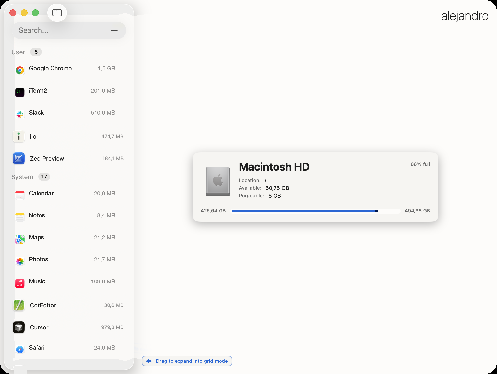
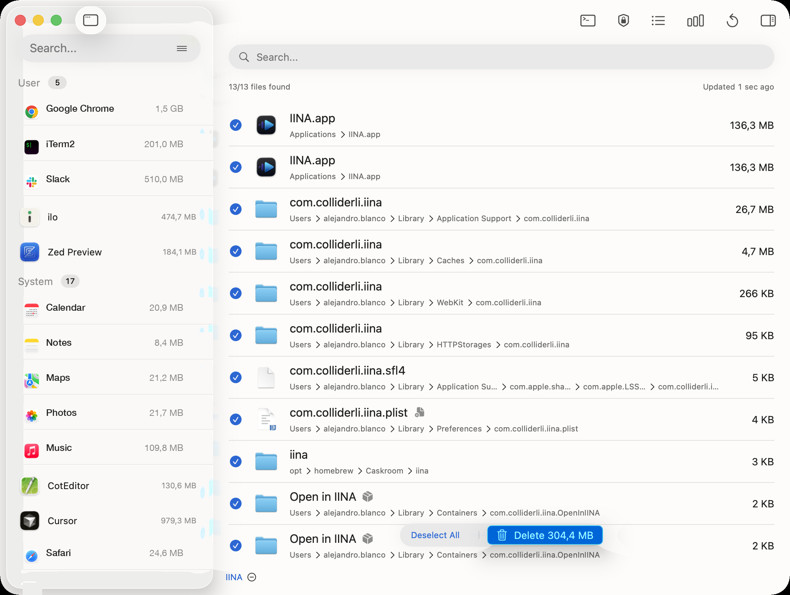
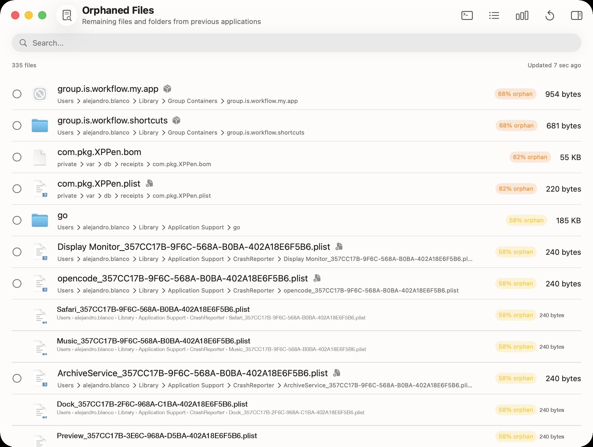
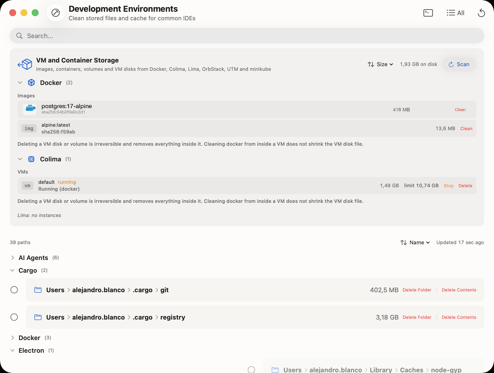
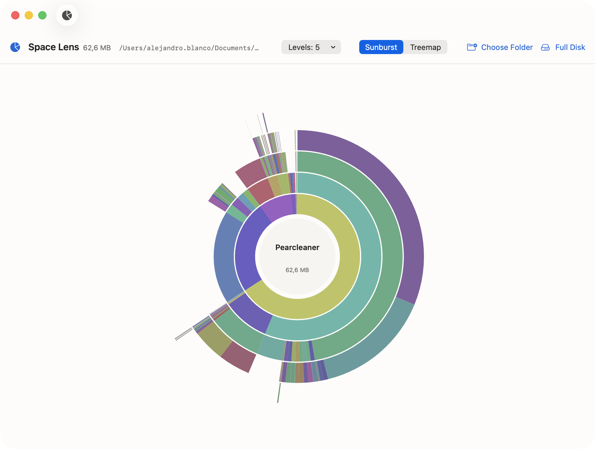
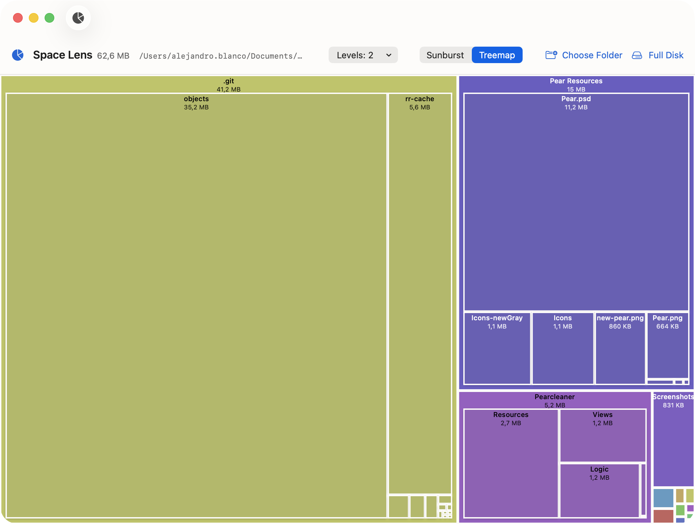

# Pearcleaner

### Website
The only legitimate website owned by me is https://itsalin.com. Anything else offering Pearcleaner downloads is either a scam or not affiliated with me.
More details [HERE](https://www.reddit.com/r/macapps/comments/1ucstzy/psa_pearcleanercom_is_a_fake_site_pushing_macos/).

### Project Status: On Hold
> As you may have noticed, development on the app has basically stopped since end of 2025, so I wanted to provide some context.
>
> Between a new job, joining a friend who is building a SaaS company, and other life priorities, I no longer have the time needed to actively maintain or continue development on the project.
>
> Another major reason is that I previously relied on my work MacBook for development. After changing jobs, I no longer have access to a Mac device that I can use for personal development work, which means I’m currently unable to build, test, or release updates for the app.
>
> Because of that, issue responses, feature work, PR reviews, and new releases are effectively on hold indefinitely for now.
>
> The project is not abandoned entirely, and I’d still like to return to it someday if circumstances change. For now though, I want to be transparent that active development is no longer possible on my end.
>
> Thank you to everyone who has used the app, reported issues, submitted ideas, or contributed. I genuinely appreciate all of the support the project has received.


<br>

<p align="center">
<!--     -->
   

   <br />
   <strong>Status: </strong>On Hold
   <br />
   <strong>Version: </strong>5.4.3
   <br />
   <a href="https://github.com/alienator88/Pearcleaner/releases"><strong>Download</strong></a>
    · 
   <a href="https://github.com/alienator88/Pearcleaner/commits">Commits</a>
  </p>
</p>
</br>


A free, source-available and fair-code licensed Mac app cleaner inspired by [Freemacsoft's AppCleaner](https://freemacsoft.net/appcleaner/) and [Sun Knudsen's Privacy Guides](https://github.com/sunknudsen/guides/tree/main/archive/how-to-clean-uninstall-macos-apps-using-appcleaner-open-source-alternative) post on his app-cleaner script.
This project was born out of wanting to learn more on how macOS deals with app installation/uninstallation and getting more Swift experience. If you have suggestions I'm open to hearing them, submit a feature request!


### Table of Contents:
[Features](#features) | [Screenshots](#screenshots) | [Issues](#issues) | [Requirements](#requirements) | [Download](#getting-pearcleaner) | [Translations](#translations) | [License](#license) | [Thanks](#thanks) | [Other Apps](#other-apps)

<br>


## Features
### Core
- **App Uninstall • Orphaned File Search • Development Environment Manager • File Search • Homebrew Manager • App Lipo • PKG Manager • Plugin Manager • Services Manager • Apps Updater • Space Lens** 
- Drag/drop apps, CLI support, and deep link automation [view](https://github.com/alienator88/Pearcleaner/wiki/Deep-Link-Guide)
- List or Grid view with badges for web/iOS apps
- Finder Extension for right-click uninstall
- Pearcleaner self-uninstall and other options

### Utilities
- Prune unused app translations, keeping only preferred languages
- Strip unneeded architectures from universal apps without requirement of lipo binary from xcode tools
- **Sentinel Monitor**: Automatic cleanup when apps hit Trash (~2MB RAM)
- Export app bundles and file lists
- Basic Steam games support

### Customization
- Theme system with custom colors
- Include/exclude directories for searching
- Adjustable search sensitivity

## Screenshots



<p></p>


<p></p>




## Issues
> [!WARNING]
> - When submitting issues, please use the appropriate issue template corresponding with your problem [HERE](https://github.com/alienator88/Pearcleaner/issues/new/choose)
> - Issues with no template will be closed
> - This is a personal/hobby app, therefore the project is fairly opinionated. Opinion-based requests (e.g., “the layout would look better this way”) will not be considered.

## Requirements
> [!NOTE]
> - Full Disk permission to search for files
> - Administrator password (asked once per session) to perform actions on system folders

| macOS Version | Codename | Supported |
|---------------|----------|-----------|
| 14.x          | Sonoma   | ✅        |
| 15.x          | Sequoia  | ✅        |
| 26.x          | Tahoe    | ✅        |
| 27.x          | TBD      | ✅        |
| TBD           | Beta     | ❌        |
> Versions prior to macOS 14.0 are not supported due to missing Swift/SwiftUI APIs required by the app.

## Getting Pearcleaner

<details>
  <summary>Releases</summary>

Pre-compiled, always up-to-date versions are available from my [releases](https://github.com/alienator88/Pearcleaner/releases) page.
</details>

<details>
  <summary>Homebrew</summary>

You can add the app via my Homebrew tap:
```
brew tap alecuba16/tap https://github.com/alecuba16/homebrew-tap
brew install --cask pearcleaner-fork
```
</details>

<details>
  <summary>Fork self-updates</summary>

This fork publishes its own releases. The app checks the [fork appcast](https://github.com/alecuba16/Pearcleaner/releases/latest/download/appcast.xml) from the Check for Updates menu item. Automatic checks on launch are opt-in from Settings, Update. Updates are EdDSA-signed (Sparkle 2) so no Developer ID certificate is needed. The upstream [release notes](https://github.com/alienator88/Pearcleaner/releases) still show in the Update tab.
</details>

## Translations
If you are able to contribute to translations for the app, please see this discussion: https://github.com/alienator88/Pearcleaner/discussions/137

## License
> [!IMPORTANT]
> Pearcleaner is licensed under Apache 2.0 with [Commons Clause](https://commonsclause.com/). This means that you can do anything you'd like with the source, modify it, contribute to it, etc., but the license explicitly prohibits any form of monetization for Pearcleaner or any modified versions of it. See full license [HERE](https://github.com/alienator88/Pearcleaner/blob/main/LICENSE.md)

## Thanks

- Much appreciation to [Freemacsoft's AppCleaner](https://freemacsoft.net/appcleaner/) and [Sun Knudsen's app-cleaner script](https://github.com/sunknudsen/guides/tree/main/archive/how-to-clean-uninstall-macos-apps-using-appcleaner-open-source-alternative) for the inspiration
- [DharsanB](https://github.com/dharsanb) for sponsoring my Apple Developer account

## Some of my apps

[Pearcleaner](https://github.com/alienator88/Pearcleaner) - An opensource app cleaner with privacy in mind

[Sentinel](https://github.com/alienator88/Sentinel) - A GUI for controlling gatekeeper status on your Mac

[Viz](https://github.com/alienator88/Viz) - Utility for extracting text from images, videos, qr/barcodes

[PearHID](https://github.com/alienator88/PearHID) - Remap your macOS keyboard with a simple SwiftUI frontend
